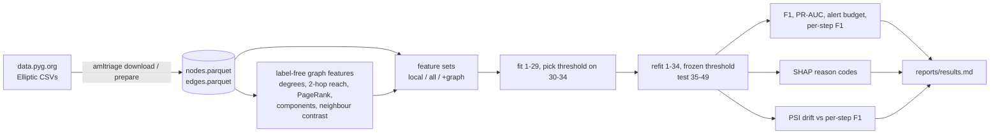

# amltriage: illicit-transaction detection on the Elliptic graph, evaluated like a compliance team would

[](https://github.com/Adversitas/elliptic-aml-triage/actions/workflows/ci.yml)

Anti-money-laundering (AML / LBC-FT) detection is a textbook case where a good offline score
can hide a useless model: labels are rare, incomplete and late, investigators can only review
a fixed number of alerts per period, and criminal behaviour changes. This project trains and
evaluates illicit-transaction detectors on the **Elliptic Bitcoin dataset** under a protocol
that respects those constraints, and reports what a compliance team would ask:

- **Strict temporal validation.** Train on time steps 1-34, test on 35-49. The decision
  threshold is chosen on steps 30-34 with a model fitted on 1-29, then frozen. Nothing from
  the test period ever informs a choice.
- **Alert-budget metrics.** Besides illicit-class precision / recall / F1 and PR-AUC: what
  share of illicit transactions lands in a review queue of the top 5 % per period.
- **Label-free graph features** (degrees, 2-hop reach, PageRank, component size, neighbour
  contrast) computed from the payment-flow graph only, so they are legal at scoring time.
- **Reason codes**: SHAP values give the top 3 drivers of each alert.
- **Drift analysis**: per-period performance next to the Population Stability Index of the
  model's top features.

**Data**: Elliptic (Weber et al., 2019), 203,769 transactions, 234,355 edges, 49 time steps,
166 anonymised features (93 local + 72 neighbourhood aggregates). 4,545 illicit, 42,019 licit,
the rest unlabelled. Labelled transactions: 29,894 for training (3,462 illicit), 16,670 for
testing (1,083 illicit, 6.5 %).

## Results

`amltriage benchmark`, 3 seeds per tree model, class-weighted (full tables in
[`reports/results.md`](reports/results.md)):

| Features | Model | Illicit F1 | Precision | Recall | PR-AUC | Recall in top-5 % queue |
|---|---|---|---|---|---|---|
| local (93) | logistic regression | 0.438 | 0.351 | 0.582 | 0.237 | 0.148 |
| all (165) | logistic regression | 0.421 | 0.396 | 0.450 | 0.312 | 0.265 |
| local | random forest | 0.753 ± 0.012 | 0.789 | 0.720 | 0.769 | 0.419 |
| local | LightGBM | 0.781 ± 0.013 | 0.888 | 0.700 | 0.790 | 0.421 |
| all | random forest | 0.798 ± 0.008 | 0.902 | 0.715 | 0.786 | 0.420 |
| all | XGBoost | 0.797 ± 0.017 | 0.871 | 0.735 | 0.803 | 0.425 |
| all | LightGBM | 0.806 ± 0.010 | 0.894 | 0.734 | 0.806 | 0.428 |
| **all + graph (175)** | **LightGBM** | **0.815 ± 0.003** | **0.919** | 0.731 | **0.807** | **0.428** |

Ablation without class re-weighting (threshold still tuned on the validation window):
LightGBM 0.819 ± 0.005 on `all`, random forest **0.663 ± 0.059** on `all`.

Per test period (LightGBM, all + graph, seed 0):

| Steps | Illicit in test | Mean illicit F1 | Mean PSI of top-10 features |
|---|---|---|---|
| 35-42 | 914 | **0.905** | 1.08 |
| 43-49 | 169 | **0.038** | 1.07 |

What the numbers say:

- **Linear models are not a usable baseline here** (F1 0.42-0.44, PR-AUC ≤ 0.31): the
  signal is in interactions between features. Tree ensembles reach 0.80-0.82 F1, in line with
  the published random-forest baseline (0.79 for RF on all features in Weber et al.).
- **The dataset's own neighbourhood aggregates matter; my extra graph features barely do.**
  Going from local to all features adds 2.5-4.5 F1 points for every tree model. Adding 10
  label-free graph features on top moves LightGBM by +0.009 (inside the seed spread of the
  `all` run, std 0.010) and slightly hurts RF and XGBoost; the best one ranks 34th in
  SHAP importance. The aggregates already encode most of the 1-hop structure.
- **Class weighting is not free.** With a tuned threshold LightGBM does not need it (0.819 vs
  0.815), but an unweighted random forest becomes unstable (0.663 ± 0.059) because its scores
  bunch near 0 and the threshold chosen on 30-34 transfers badly. Weighting is a robustness
  choice more than an accuracy one.
- **Under a 5 % review budget, about 43 % of illicit transactions are caught.** Since illicit
  transactions are 6.5 % of the test set, a perfect ranker could catch at most 53 % in that
  budget, so the model reaches 81 % of the ceiling. Precision in the queue is 0.55.
- **The model collapses after the dark-market shutdown, and feature drift does not see it
  coming.** F1 is 0.905 on steps 35-42 and 0.038 on 43-49, the well-known break in Elliptic
  after a major dark market closed: new illicit patterns appear that the training labels never
  covered. Mean PSI of the top features is the same before and after (1.08 vs 1.07,
  correlation with per-step F1 = 0.10). **Input-drift monitoring alone would have stayed
  green**; only fresh labels (investigation outcomes) reveal this kind of concept drift, which
  is why a production AML model needs a feedback loop and periodic backtesting, not just PSI.
- **Reason codes are concrete**: every alert ships with its top-3 SHAP drivers (feature,
  value, contribution). All 10 highest-scored test alerts are true illicit transactions.

## Architecture



| Module | Role |
|---|---|
| [`data.py`](src/amltriage/data.py) | Download, parquet conversion, temporal split. |
| [`graph_features.py`](src/amltriage/graph_features.py) | Sparse-matrix graph features, PageRank by power iteration, no labels used. |
| [`models.py`](src/amltriage/models.py) | Feature sets and models (logistic regression, RF, LightGBM, XGBoost) with optional class weighting. |
| [`metrics.py`](src/amltriage/metrics.py) | F1-optimal threshold, illicit P/R/F1, alert-budget precision/recall per period, PSI. |
| [`experiment.py`](src/amltriage/experiment.py) | Temporal protocol, multi-seed benchmark, SHAP explanations, drift table. |

## How to run

```bash
pip install -e ".[dev]"
amltriage download     # about 150 MB zipped from data.pyg.org
amltriage prepare
amltriage benchmark                      # 4 feature sets x 4 models x 3 seeds (about 20 min CPU)
amltriage benchmark --unbalanced --feature-sets all all+graph --models rf lgbm xgb
amltriage explain                        # SHAP + drift, needs the balanced benchmark
amltriage report
```

The experiment outputs (`reports/*.json`) are committed. CI runs ruff, the test suite (on a
small synthetic graph with the Elliptic schema, plus hand-checked graph features) and rebuilds
the results page from the committed JSON.

## Limitations

- Elliptic features are anonymised, so reason codes name `local_52`, not "number of inputs";
  on real data the same code would produce readable explanations.
- Labels exist for only 23 % of transactions and are not uniformly sampled; "unknown" nodes are
  ignored for training and evaluation rather than modelled (positive-unlabelled learning would
  be a natural next step).
- Three seeds give a rough idea of variance, not tight confidence intervals.
- No graph neural network is included; published GCN results on this split are below the tree
  ensembles, and the point here is the evaluation protocol.

## En bref (FR)

Détection de transactions illicites (LBC-FT) sur le graphe Bitcoin **Elliptic**, avec une
**validation strictement temporelle** (apprentissage sur les périodes 1-34, seuil choisi sur
30-34, test sur 35-49), des métriques de **budget d'alertes**, des **explications SHAP** par
alerte et une **analyse de dérive**. LightGBM atteint un F1 de 0,815 sur la classe illicite
(PR-AUC 0,807), contre 0,42-0,44 pour une régression logistique. Avec une file de revue
limitée à 5 % des transactions par période, 43 % des transactions illicites sont détectées
(81 % du maximum atteignable). Surtout, le modèle s'effondre après la fermeture d'un grand
marché noir (F1 0,905 puis 0,038) alors que l'indicateur de dérive PSI ne bouge pas : seule une
boucle de retour des enquêtes permet de détecter ce type de dérive conceptuelle.

## License

MIT for the code. The Elliptic dataset is distributed by Elliptic for research use (via
PyTorch Geometric's mirror); it is not redistributed here.
